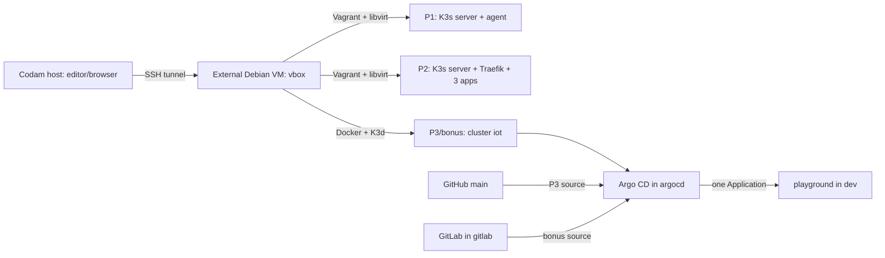
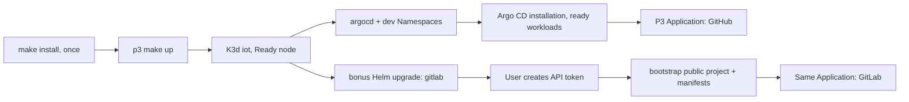
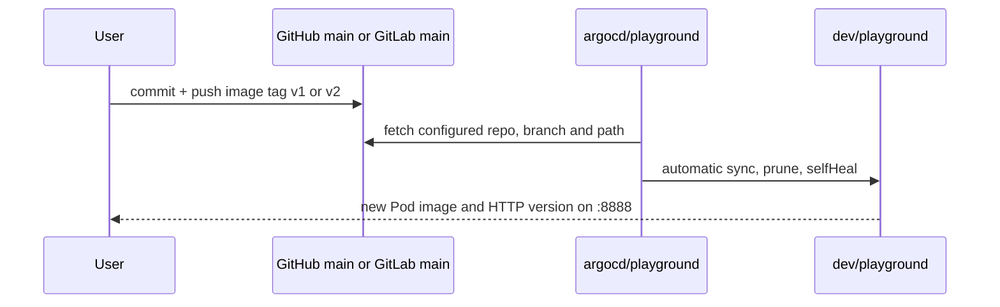

# Developer guide

This guide explains the repository's configuration and the order in which its components start. [README.md](README.md) provides the run commands.

## Architecture and execution boundaries



The Codam host has no `sudo`. Install system packages, run Vagrant and K3d, and query the cluster on the external Debian VM. P1/P2 Kubernetes commands execute in a Vagrant guest through `vagrant ssh`; P3/bonus Kubernetes commands execute on the Debian VM using `--context=k3d-iot`. A Codam SSH tunnel can expose Debian VM loopback ports without exposing the cluster API or changing manifests. The `192.168.56.0/24` libvirt network may not be directly reachable from Codam.

`p1` and `p2` share private server IP `192.168.56.110`. They must not run simultaneously. P3 and bonus share **one** K3d cluster, one `dev/playground` Deployment, and one `argocd/playground` Application. Their setup scripts both apply the same Application name with different Git sources, so the last setup run selects the source.

## File map and execution order

| Path | Purpose / order |
| --- | --- |
| `Makefile` | Root P1/P2 entry point; default `PART=p2`, default goal `check`; `up` runs `prepare`, `check`, then `vagrant up` |
| `scripts/prepare.sh` | Validates Vagrant/libvirt, configures Intel EPT workaround, defines/starts system libvirt `iotnet` |
| `scripts/check.sh` | Checks EPT, `iotnet`, libvirt access, Vagrant syntax, and other part's server-name conflict |
| `p1/Vagrantfile` | Defines `osivkovS` and `osivkovSW`, network, file uploads and provisioners |
| `p1/scripts/common.sh` | Guest apt packages, hosts file, swap, SSH key installation |
| `p1/scripts/server.sh` | Installs unpinned K3s server on `.110` |
| `p1/scripts/worker.sh` | Retrieves join token by SSH, installs K3s agent on `.111` |
| `p1/confs/iotnet.xml`, `p2/confs/iotnet.xml` | Identical `iotnet` NAT network definitions |
| `p1/confs/cluster_key`, `.pub` | Ignored local SSH key pair, uploaded to both P1 guests; never publish the private key |
| `p1/confs/node-token` | Ignored local file; no script consumes it |
| `p2/Vagrantfile` | Defines one `osivkovS` guest, uploads `confs/`, runs server script |
| `p2/scripts/server.sh` | Guest apt packages, pinned K3s server, node readiness, applies app1–3 and Ingress, waits for Deployments |
| `p2/confs/app1.yaml` | ConfigMap with HTML, Nginx Deployment and Service |
| `p2/confs/app2.yaml` | Three-replica HTTP echo Deployment and Service |
| `p2/confs/app3.yaml` | One-replica default HTTP echo Deployment and Service |
| `p2/confs/ingress.yaml` | Traefik routes for `app1.com`, `app2.com`, and hostless fallback |
| `p3/scripts/install.sh` | Apt Docker/curl/CA, starts Docker, grants Docker group, downloads checksum-verified K3d and kubectl |
| `p3/scripts/up.sh` | Creates/starts cluster, chooses context, applies namespaces and vendored Argo CD, waits, applies P3 Application unless `SKIP_APPLICATION=true` |
| `p3/Makefile` | Install/start/stop/status, UI and app port forwards, and `source-p3` / `source-bonus` targets for changing the Application source in a running cluster |
| `p3/confs/cluster.yaml` | K3d cluster `iot`, one K3s server, load-balancer loopback port mapping |
| `p3/confs/namespaces.yaml` | `argocd` and `dev` Namespaces |
| `p3/confs/argocd-install.yaml` | Vendored Argo CD v3.3.16 installation and CRDs; applied server-side |
| `p3/confs/argocd-application.yaml` | GitHub source and automated sync for `argocd/playground` |
| `p3/confs/application/*.yaml` | GitHub-managed Deployment and Service for `dev/playground` |
| `p3/app/one-more-cup/` | Static application source, Dockerfile, release descriptors, container smoke check, and application tests |
| `bonus/scripts/install-helm.sh` | Downloads checksum-verified Helm v4.3.1 binary and installs it with `sudo` |
| `bonus/scripts/up.sh` | Starts P3 with `SKIP_APPLICATION=true`, upgrades Helm release, optionally bootstraps GitLab and switches Application source |
| `bonus/scripts/bootstrap-gitlab.py` | GitLab API login, public group/project creation, first commit containing seed manifests |
| `bonus/charts/gitlab/` | Local Helm chart with ConfigMap, Deployment, Service, Ingress and three PVCs |
| `bonus/confs/namespace.yaml` | `gitlab` Namespace |
| `bonus/confs/application/*.yaml` | Seed Deployment and Service sent to a new GitLab project |
| `bonus/confs/argocd-application.yaml` | GitLab source for the **same** Argo CD Application |

The scripts resolve their own paths, but both Makefiles depend on the current directory: root `make` must run at the repository root and P3 `make` at `p3`. `p1` and `p2` Vagrant commands must run inside their corresponding directories. `p3/scripts/up.sh` and `bonus/scripts/up.sh` can be called by absolute or root-relative path. The bootstrap Python script resolves its seed directory from its file location, but its API endpoint is fixed to `http://localhost:8080` on the Debian VM.

### P1 provisioning sequence


P1 uses the Debian `debian/trixie64` box, with 2 vCPU/2048 MiB for the server and 1 vCPU/1024 MiB for the worker. Vagrant gives each guest a management interface for SSH and an additional private interface carrying `.110` or `.111`. Use `ip -4 addr` in each guest to identify the interfaces.

The `common.sh` key setup enables passwordless worker-to-server SSH, but it disables SSH host key checking for `192.168.56.*`. The private key is copied to both guests. `server.sh` performs a nonfatal 30-second `kubectl get nodes`; successful provisioning therefore does not establish both nodes `Ready`. `worker.sh` retries token retrieval for up to about two minutes. K3s includes its own `kubectl` command; P1 uses `sudo k3s kubectl` in checks, though the install script's `kubectl` may also be available in the guest.

### P2 provisioning sequence

`make up PART=p2` performs the same preparation/check, creates a Debian guest with 3 vCPU/3072 MiB, uploads `p2/confs/`, then runs `p2/scripts/server.sh`. The script installs `v1.36.5+k3s1` if `k3s` is absent, starts its service, waits for the API and node readiness, applies four manifests to `default`, and waits for all three Deployments. A repeated `vagrant up` of an existing guest does not necessarily rerun provisioning; after changing manifests, run `cd p2 && vagrant provision osivkovS` on the Debian VM.

The K3s install flags use `--flannel-iface eth1`. If the guest uses another interface name, check the interface carrying `.110` before provisioning. Reprovisioning only changes the K3s version if it was absent on first run.

### P3 and bonus sequence



`p3/scripts/install.sh` pins K3d `v5.9.0` and kubectl `v1.36.5`; it checks downloaded SHA-256 files. It installs Docker through apt and adds the invoking user to the `docker` group. A **new login session** is required for group membership. `p3/scripts/up.sh` requires Docker access, creates/starts `iot`, selects `k3d-iot` as the current kubectl context, waits for the node, applies namespaces and Argo CD, waits for its Deployments and application-controller StatefulSet, and usually applies the GitHub Application. It does not check the availability of the public GitHub repo before waiting for `Synced/Healthy`.

`bonus/scripts/up.sh --setup-only` invokes P3 setup with `SKIP_APPLICATION=true`, applies namespace `gitlab`, and uses `helm upgrade --install --wait --timeout 10m`. It then stops **before** token/bootstrap/Application switching. This is still an infrastructure-changing command: it starts/reapplies P3 and upgrades GitLab. A normal bonus run repeats those operations, prompts for a GitLab API token, seeds a public group/project if absent, applies the GitLab Application source, requests hard refresh, and waits for `Synced/Healthy`. Bootstrap leaves a nonempty project untouched without checking its `main` branch, two files, or current image version. The Application YAML hard-codes `osivkov/iot`, so environment overrides of the bootstrap group/project require a matching manual Application edit.

## Networks, ports, contexts, namespaces and objects

| Environment | Network / access | Kubernetes objects |
| --- | --- | --- |
| P1 guest | libvirt `iotnet` NAT `192.168.56.0/24`, bridge `virbr56`, gateway `.1`; `.110` server API TCP 6443; `.111` agent; guest SSH via Vagrant management NIC | Two Nodes; K3s server and agent services |
| P2 guest | Same `iotnet`; HTTP `192.168.56.110:80`; Traefik Ingress | In `default`: ConfigMap `app1-page`, Deployments and Services `app1/app2/app3`, Ingress `apps` |
| P3/bonus VM | Docker/K3d network; K3d load balancer maps Debian VM `127.0.0.1:8080` to LB port 80 | `argocd`: Argo CD resources and Application `playground`; `dev`: Deployment and ClusterIP Service `playground` |
| Bonus | GitLab Ingress Host `localhost` via mapped `:8080`; internal Service `gitlab.gitlab.svc.cluster.local:80`; app Service `dev/playground:8888` | `gitlab`: Helm release `gitlab`, ConfigMap, Deployment, Service, Ingress and three PVCs |

The P2 Ingress selects `app1.com` and `app2.com`; its rule without a Host routes other Hosts to `app3`. App1 listens on 80; app2/app3 containers listen on 5678 and their Services expose 80. All Services are `ClusterIP`. P3's application has no Ingress: `kubectl --context=k3d-iot -n dev port-forward svc/playground 8888:8888` on the Debian VM exposes it at `127.0.0.1:8888`. `kubectl --context=k3d-iot -n argocd port-forward svc/argocd-server 9090:443` exposes the Argo CD UI at `https://127.0.0.1:9090`.

Use an explicit `--context=k3d-iot` for manual cluster queries. `p3/scripts/up.sh` changes the user's current kubectl context globally, which can surprise someone using another cluster. The P1/P2 guest `k3s kubectl` uses the guest's local K3s configuration. Do not paste or publish a complete kubeconfig.

## Git → Argo CD → application



P3's source is `https://github.com/osivkov/inception-of-things.git`, branch `main`, path `p3/confs/application`. Bonus changes **the same** Application to `http://gitlab.gitlab.svc.cluster.local/osivkov/iot.git`, branch `main`, path `.`. Both use project `default`, destination namespace `dev`, automated sync with prune and self-heal. The bootstrap script creates a public GitLab project `osivkov/iot` with `deployment.yaml` and `service.yaml` on `main` when that project is empty.

The P3 and bonus manifests now declare one `playground` replica from `osivkov/one-more-cup:v2`. The resource names and `app: playground` selector are retained so the `ClusterIP` Service continues to target the Pod on port `8888`. One More Cup's source is in `p3/app/one-more-cup/`, while the public Docker Hub repository provides separate `v1` and `v2` images. The subject permits an own application with two visibly different versions; port `8888` is required for Wil's example and is also used here.

Both images use the same static HTML, CSS, and JavaScript build context. The Dockerfile's `APP_VERSION` build argument copies either `releases/v1.json` or `releases/v2.json` into the image as `/version.json`. The client reads that file at startup: v1 uses green colors and the `FIRST BREW / 001` label; v2 uses terracotta colors and `SLOW ROAST / 002`. Timer and task behavior is the same in both releases. The HTTP responses are `{"version":"v1"}` and `{"version":"v2"}`. Changing an environment variable on an existing container does not change its built release.

To rebuild or republish either tag, run from the **external Debian VM**. Sign in interactively; do not place Docker Hub credentials in commands or files:

```bash
cd ~/inception-of-things/p3/app/one-more-cup
docker buildx build --platform linux/amd64 --load --build-arg APP_VERSION=v1 -t osivkov/one-more-cup:v1 .
docker buildx build --platform linux/amd64 --load --build-arg APP_VERSION=v2 -t osivkov/one-more-cup:v2 .
sh scripts/smoke-container.sh osivkov/one-more-cup:v1 v1 8888
sh scripts/smoke-container.sh osivkov/one-more-cup:v2 v2 8888
docker login -u osivkov
docker push osivkov/one-more-cup:v1
docker push osivkov/one-more-cup:v2
```

Republishing an existing tag changes what future pulls may receive; for a repeatable defense, retain the published v1/v2 contents after verification. For P3, change the image tag in `p3/confs/application/deployment.yaml`, commit, and push to the configured GitHub `main` branch. For bonus, edit and commit `deployment.yaml` in the existing GitLab project `osivkov/iot` on `main`. The files under `bonus/confs/application/` seed an **empty** project; bootstrap does not overwrite an existing project's manifests. After either change, verify the new Argo CD revision, ready Pod image, and `/version.json` through the Service. A local Docker image on the Debian VM is not automatically present in the K3d node; Kubernetes pulls the public image.

On 2026-10-23, the active Application read the local GitLab repository, was `Synced/Healthy`, and managed one ready `dev/playground` Pod running `osivkov/one-more-cup:v2`. The Pod returned `{"version":"v2"}` from `/version.json`. Both Docker Hub tags resolved to different image digests.

## Storage, backup and restore

One More Cup stores tasks and preferences in the browser's `localStorage` for the current origin. It has no backend database or PVC, so tasks do not sync between browsers or devices. Updating the image while keeping the same browser URL preserves that browser's data.

The bonus chart runs the **Omnibus GitLab CE container** `gitlab/gitlab-ce:19.5.1-ce.0` in a custom Helm chart. It mounts three `local-path` PVCs: `gitlab-config` (1 GiB) at `/etc/gitlab`, `gitlab-data` (10 GiB) at `/var/opt/gitlab`, and `gitlab-logs` (2 GiB) at `/var/log/gitlab`. Data survives Pod recreation and ordinary K3d stop/start while the node and Docker storage remain intact. A PVC is **not** an external backup; keep a separate copy outside the cluster.

Check the [GitLab release page](https://docs.gitlab.com/releases/) before changing the pinned image tag.

**Backup procedure, Debian VM, before any restore or destructive maintenance:** use the exact current GitLab Pod name and store the archive **outside** the K3d cluster. Run when enough disk is available and preferably during a quiet period. Do not paste the resulting secrets into logs or chat.

```bash
kubectl --context=k3d-iot -n gitlab get pods -l app=gitlab
kubectl --context=k3d-iot -n gitlab exec deploy/gitlab -- gitlab-backup create
kubectl --context=k3d-iot -n gitlab exec deploy/gitlab -- ls -lh /var/opt/gitlab/backups
# Replace <pod> and <archive> with the names printed above; choose a protected VM path.
kubectl --context=k3d-iot -n gitlab cp <pod>:/var/opt/gitlab/backups/<archive> <protected-vm-backup-dir>/<archive>
# Separately and securely copy /etc/gitlab/gitlab-secrets.json and gitlab.rb from the config PVC.
```

The GitLab backup archive does not include `/etc/gitlab` secrets/configuration; back these up separately with restrictive permissions, along with the Helm chart/values and the GitLab repository state. GitLab's [backup documentation](https://docs.gitlab.com/administration/backup_restore/backup_gitlab/) covers this Omnibus layout.

**Restore plan:** work on an isolated or stopped application after first confirming a usable archive and protected config/secrets backup. Use the **exact same GitLab CE version** as the archive, sufficient free space (GitLab documents at least three times the archive size in the backup directory), restore `/etc/gitlab/gitlab-secrets.json` and relevant configuration, place the archive in `/var/opt/gitlab/backups` with the required `git` ownership, stop Puma and Sidekiq while keeping the remaining GitLab services running, run `gitlab-backup restore BACKUP=<archive-id>` inside the GitLab container, restart services, and validate GitLab login, repository content, and Argo CD sync. Restoring replaces destination GitLab data; follow the exact [GitLab restore procedure](https://docs.gitlab.com/administration/backup_restore/restore_gitlab/). The current chart provides no automated restore workflow.

## Repeated runs and configuration changes

The root `Makefile` runs `prepare` and `check` before `vagrant up`. It does not install Vagrant/libvirt or create the P1 SSH key pair. An existing Vagrant guest may skip provisioning; use `vagrant provision` after changing guest scripts or manifests.

`p3/scripts/up.sh` reuses or starts the `iot` cluster, reapplies namespaces and Argo CD, and selects the GitHub Application unless `SKIP_APPLICATION=true`. It also changes the current kubectl context to `k3d-iot`. `bonus/scripts/up.sh` invokes P3 setup with `SKIP_APPLICATION=true`, runs `helm upgrade --install`, then selects the GitLab Application after bootstrap. Run these setup commands sequentially and check the Application source afterward. In an already running cluster, `make source-p3` and `make source-bonus` from `p3` switch only the Application definition and request a hard refresh; they do not start the cluster or wait for sync.

The bootstrap script creates the project and initial commit only when the repository is empty. If the project already contains commits, update its manifests in GitLab. The application manifests also exist in `p3/confs/application/` and `bonus/confs/application/`; changes to one location do not update the other.

## Diagnostics

| Symptom | Where and what to check |
| --- | --- |
| Root `make up` fails before Vagrant | Debian VM root: `make check PART=p1` or `PART=p2`; inspect `vagrant validate`, `virsh -c qemu:///system net-list`, EPT setting and sudo availability. `prepare` can reconfigure KVM; do not run with active libvirt guests. |
| P1 worker absent | Debian VM `p1`: `vagrant ssh osivkovSW -c 'sudo systemctl status k3s-agent --no-pager'`; test worker-to-server SSH; inspect server K3s and TCP 6443. Keep the join token private. |
| P2 Ingress fails or app2 lacks replicas | Debian VM `p2`: `vagrant ssh osivkovS -c 'sudo k3s kubectl get pods,deploy,svc,ingress -o wide'`; compare actual private NIC to hard-coded `eth1`; use curl Host headers. |
| `docker info` denied | Debian VM: inspect Docker service and session group membership; log out/in after installer added the group. |
| K3d/Argo CD pending | Debian VM: `k3d cluster list`, `kubectl --context=k3d-iot -n argocd get pods`, and `kubectl --context=k3d-iot -n argocd describe application playground`; check RAM/disk and image pulls. |
| GitLab pod unready or HTTP unavailable | Debian VM: `kubectl --context=k3d-iot -n gitlab get pods,pvc,ingress`, `kubectl --context=k3d-iot -n gitlab describe pod -l app=gitlab`; inspect CPU/RAM and `curl -I -H 'Host: localhost' http://127.0.0.1:8080/`. Traefik returns 404 for the loopback IP without Host `localhost`; that does not prove GitLab is down. Do not dump secrets. |
| Bootstrap fails | Debian VM: verify GitLab HTTP/API readiness at `localhost:8080`, token `api` scope, public group/project permissions, and `main` branch. The prompt consumes the token without echo. |
| Argo CD stays OutOfSync/Degraded | Debian VM: compare `.spec.source.repoURL`, branch/path, `.status.sync.revision`, Application conditions, `dev` Pod events and image. Check whether P3 or bonus last applied the Application. |
| App works on VM but not Codam | Keep VM port forward and Codam `ssh -L` alive; check local port conflicts and tunnel target. GitLab uses the K3d `:8080` mapping, while app/UI need separate port forwards. |
